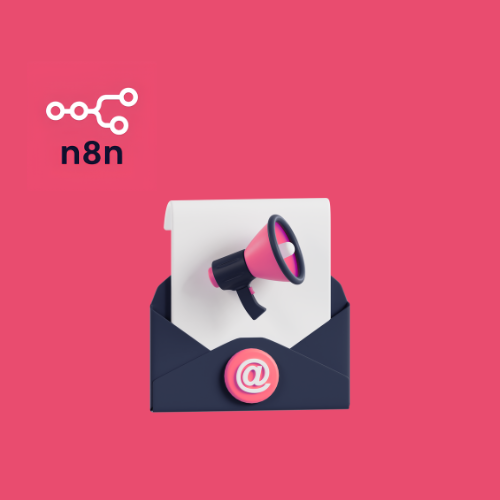
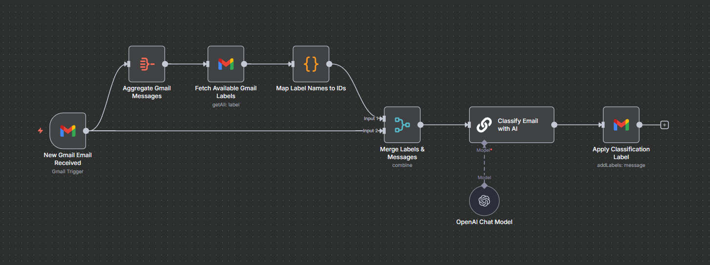

# AI-Powered Gmail Email Auto-Classification

This automation polls a Gmail inbox for new emails and uses a Google Gemini chat model to assign each one a single label. It then applies that label to the email in Gmail.

## Overview

Incoming email needs sorting by what it asks of the recipient, such as a reply, an action, or a review. The system uses one workflow. A Gmail trigger detects each new email, and a second branch loads the mailbox labels into a name-to-ID lookup. The email and the lookup are merged, passed to an AI classification node, and the returned label name selects the label to apply.

## Workflows

| Workflow | Trigger | Purpose |
| --- | --- | --- |
| AI-Powered Gmail Email Auto-Classification Automation | Gmail Trigger, polling every minute | Classifies each new Gmail email with an AI model and applies the matching label. |

## Workflow Details

### AI-Powered Gmail Email Auto-Classification Automation

This workflow labels each new Gmail email with one of nine categories chosen by an AI model.

**Trigger:** The Gmail Trigger node, named New Gmail Email Received, polls the connected Gmail account every minute for new emails.

Execution steps:

1. New Gmail Email Received detects a new email and sends it to two paths at once.
2. Aggregate Gmail Messages combines the incoming items into a single item.
3. Fetch Available Gmail Labels retrieves every label in the mailbox with its name and Gmail label ID.
4. Map Label Names to IDs runs a Code node that turns the label list into one lookup object keyed by label name.
5. Merge Labels & Messages combines the lookup object with the original email from the second path, using the combine all mode.
6. Classify Email with AI sends the sender, recipient, subject, and snippet to the chat model with the category definitions. The prompt tells the model to return only the exact label name.
7. Google Gemini Chat Model supplies the language model to the classification node.
8. Apply Classification Label looks up the label ID in the lookup object using the model's response and adds that label to the original email.

Branching and merging:

- The trigger output splits into two parallel paths.
- The first path aggregates the email, fetches the labels, and builds the lookup object.
- The second path sends the original email straight to the merge node.
- The workflow contains no conditional branches, loops, or sub-workflow calls.

Classification labels:

- Reply Needed: direct questions or personal threads that expect your answer.
- Action Required: failed payments, identity verification, restricted access, and other prompts you must resolve.
- Review & Feedback: requests to comment on or approve a document, design, proposal, or teammate's work.
- System Updates: automated receipts, security alerts, package tracking, and monitored-event alerts.
- Calendar & Meetings: invitations, schedule changes, cancellations, and calendar summaries.
- Waiting For Others: follow-ups and reminders about a response you have not yet sent.
- Done & Confirmed: confirmations of actions you started yourself.
- Promotions & News: newsletters, offers, product announcements, and automated feedback surveys.
- Miscellaneous: any email that fits none of the other categories.

Error handling:

- Every node except the chat model retries on failure, waiting three seconds between tries.
- The workflow settings reference an error workflow that runs when an execution fails.

Integrations used: Gmail, Google Gemini.

## Integrations

- Gmail: trigger on new email, label retrieval, and label assignment.
- Google Gemini: language model for email classification.

## Prerequisites

- An n8n instance.
- A Gmail account.
- A Gmail OAuth2 credential for the Gmail Trigger node and both Gmail nodes.
- A Google Gemini (PaLM) API credential for the chat model node.
- Gmail labels that already exist in the mailbox, named exactly as the nine categories above, including any emoji prefix. The workflow looks up label IDs by these names and does not create labels.

## Setup

1. Import the workflow JSON file from the `workflows` directory into n8n.
2. Create a Gmail OAuth2 credential in n8n and assign it to New Gmail Email Received, Fetch Available Gmail Labels, and Apply Classification Label.
3. Create a Google Gemini (PaLM) API credential and assign it to Google Gemini Chat Model.
4. Create the nine labels in Gmail with names that match the classification prompt exactly.
5. Review the node parameters, including the classification prompt.
6. Select an error workflow in the workflow settings, or clear the existing error workflow setting if you do not use one.
7. Activate the workflow.
